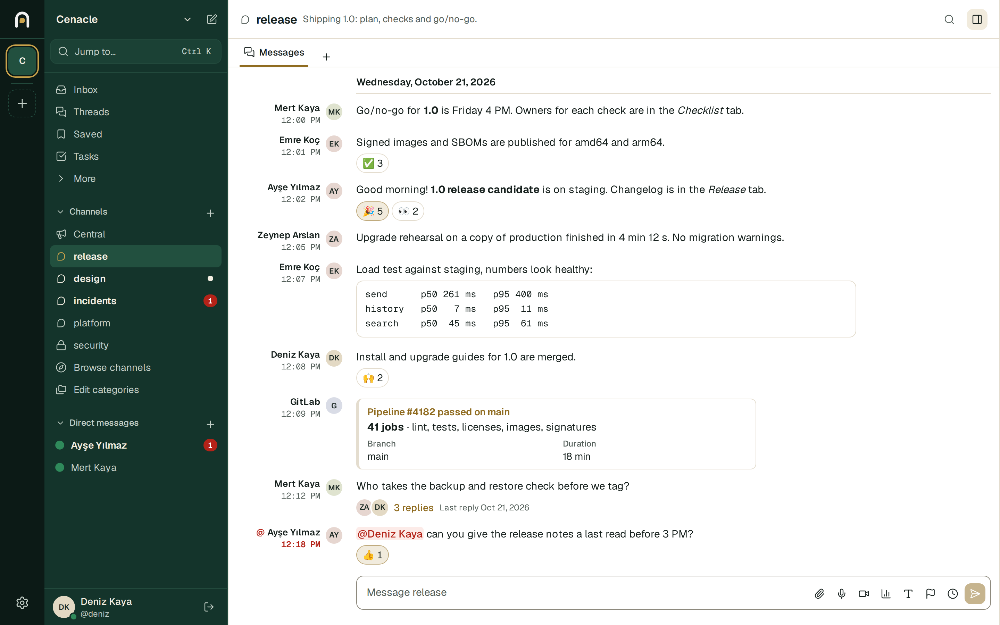
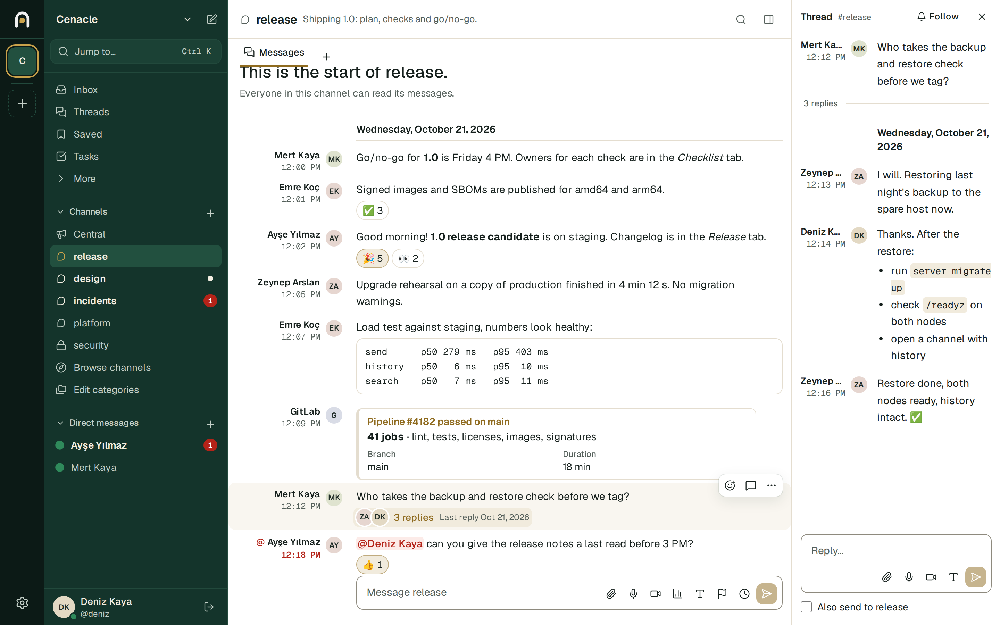
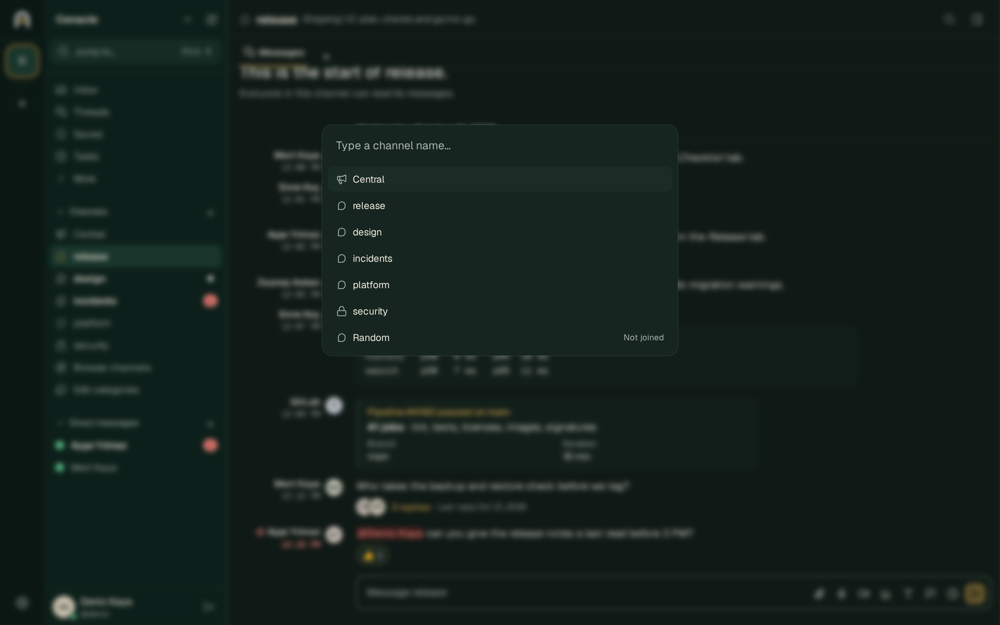
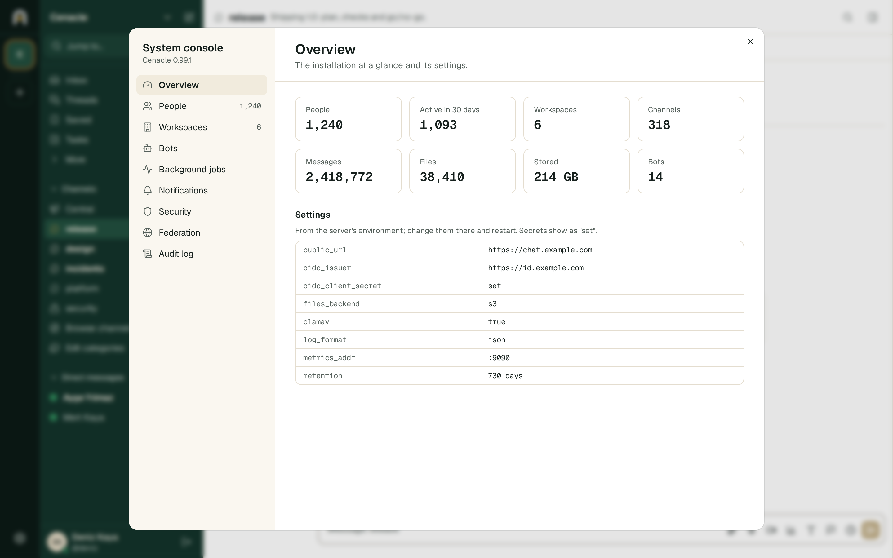
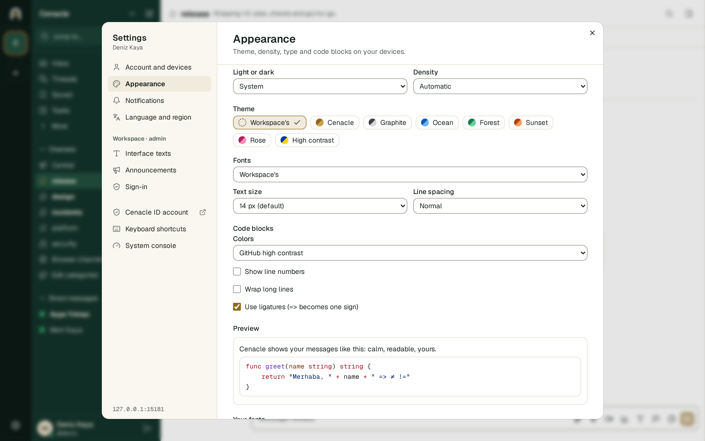
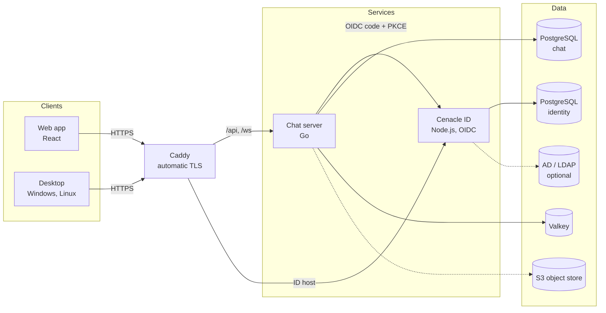

<p align="center">
  <picture>
    <source media="(prefers-color-scheme: dark)" srcset="web/public/brand/cenacle-lockup-dark.svg" />
    
  </picture>
</p>

<h3 align="center">The upper room for your organization's conversations.</h3>

<p align="center">
  Team chat and its own identity server, open source from end to end,<br />
  running on your servers and nowhere else.
</p>

<p align="center">
  <a href="docs/install/README.md"><b>Install</b></a> &nbsp;·&nbsp;
  <a href="#everything-is-included">Features</a> &nbsp;·&nbsp;
  <a href="docs/security/README.md">Security</a> &nbsp;·&nbsp;
  <a href="docs/operations/performance.md">Performance</a> &nbsp;·&nbsp;
  <a href="CHANGELOG.md">Changelog</a>
</p>

<p align="center">
  <picture>
    <source media="(prefers-color-scheme: dark)" srcset="docs/screenshots/channel-dark.png" />
    
  </picture>
</p>

---

A cenacle is the upper room where a small group gathers to talk behind a closed door.
Cenacle is that room for your teams: channels, threads and direct conversations, files,
bots and workflows, with a sign-in that belongs to you as well. It installs with one
command, works in networks that never see the internet, and sends nothing home. There is
no telemetry, no CDN, no license key and no edition with the good parts removed.

## Why Cenacle

<table>
  <tr>
    <td width="50%" valign="top">
      <h4>Yours, completely</h4>
      Every byte stays on your hardware: messages, files, search, even the optional AI,
      which talks only to the model you point it at. One <code>docker compose</code> stack or a Helm
      chart, multi-arch images, non-root containers, air-gapped installs from pre-pulled
      images.
    </td>
    <td width="50%" valign="top">
      <h4>Identity built in</h4>
      <b>Cenacle ID</b> ships alongside the chat: passwords with two-step verification,
      passkeys, Active Directory and LDAP with group mapping, or your own OpenID Connect and
      SAML providers. The chat signs in through it with OAuth 2.0 best current practice
      (RFC 9700) and keeps its own sessions, which people see and end per device.
    </td>
  </tr>
  <tr>
    <td width="50%" valign="top">
      <h4>Everything is included</h4>
      Compliance exports, legal holds, SCIM provisioning, end-to-end encryption, clustering,
      permission schemes: the features other chat platforms keep for enterprise plans are
      part of the one open-source release. Nothing is locked, metered or phoned home.
    </td>
    <td width="50%" valign="top">
      <h4>Calm by design</h4>
      Red only when something needs you. Nothing moves or disappears unexpectedly, every
      destructive action can be undone or asks first, and drafts are never lost. Keyboard
      first, WCAG 2.2 AA, dark and light, compact and comfortable, English and Turkish.
    </td>
  </tr>
</table>

## A tour

<table>
  <tr>
    <td width="50%" valign="top">
      <br />
      <b>Conversations that stay readable.</b> Threads beside the channel, an inbox for
      what needs you, saved items, pins, reminders and scheduled messages.
    </td>
    <td width="50%" valign="top">
      <br />
      <b>Everywhere in two keystrokes.</b> <kbd>Ctrl</kbd> <kbd>K</kbd> jumps to any channel;
      search finds messages, files and the text inside canvases.
    </td>
  </tr>
  <tr>
    <td width="50%" valign="top">
      <br />
      <b>Administration in the same app.</b> A system console for people, workspaces, bots,
      background jobs, security and the audit log.
    </td>
    <td width="50%" valign="top">
      <br />
      <b>Made to fit.</b> Theme presets for the workspace and for each person, fonts
      (bring your own), text size, density and code block styles.
    </td>
  </tr>
</table>

## Everything is included

<table>
  <tr>
    <td width="33%" valign="top">
      <h4>Talk</h4>
      Public, private and announcement channels in categories · direct and group
      conversations · threads · Markdown with code highlighting · mentions, reactions,
      custom emoji · voice messages · polls · forums · events · message priority and
      acknowledgements · read receipts (off unless enabled) · link previews · forwarding
    </td>
    <td width="33%" valign="top">
      <h4>Work</h4>
      Files with previews and virus scanning · canvases, lists, boards and tasks as channel
      tabs · workflows, forms and approvals · playbooks · scheduled messages and reminders ·
      search across messages, files and canvases · notifications with sounds, muting and
      quiet hours · web push and e-mail
    </td>
    <td width="33%" valign="top">
      <h4>Connect</h4>
      Bots with scoped tokens · incoming webhooks · slash commands · signed event
      subscriptions · interactive messages and dialogs · bot SDKs · Jira, GitLab, GitHub and
      Alertmanager built in · federation between Cenacle servers · optional AI with a model
      you host
    </td>
  </tr>
  <tr>
    <td width="33%" valign="top">
      <h4>Protect</h4>
      End-to-end encryption with device keys (MLS, RFC 9420) · FIPS 140-3 builds ·
      STIG-hardened images · signed releases with signed SBOMs · reproducible images ·
      session and network policies · notification content policy · SSRF-guarded egress
    </td>
    <td width="33%" valign="top">
      <h4>Comply</h4>
      Retention · legal holds · eDiscovery · compliance and archive export · audit log with
      SIEM export · data subject requests · spillage handling · classification of channels ·
      access rules · guest accounts and guest links
    </td>
    <td width="33%" valign="top">
      <h4>Run</h4>
      Several instances behind one address · OpenTelemetry, Prometheus, Loki, Tempo and
      Grafana · WAL-G backups · locked, documented migrations · SCIM provisioning ·
      permission schemes · importers for other chat products' export files · workspace moves
      between servers
    </td>
  </tr>
</table>

**Desktop:** a native app for Windows (packaged for the Microsoft Store too) and Linux that
signs in inside its own window, keeps its session in the system keychain and updates from
your server ([guide](docs/install/desktop.md)). Next: voice and video calls come with 1.0,
the mobile apps with 1.1; a macOS app later.

## Measured, not promised

Numbers from the project's own tests (the 1.0 code, medians of three runs on 2026-11-05) on one
12-core machine with PostgreSQL, Valkey and the test on the same host
([details](docs/operations/performance.md)):

| With 2,000,000 messages in 200 channels | Median | 95th percentile |
| --------------------------------------- | -----: | --------------: |
| Open the channel list with counts       |  36 ms |           63 ms |
| Load the newest page of a channel       |   7 ms |           11 ms |
| Page far back into history              |   8 ms |           11 ms |
| Search for a common word                |  45 ms |           61 ms |

- **366 messages per second** from 100 people sending without pause, each delivered live to
  200 connections, with no failed request.
- **About 400 million fuzzed inputs** across 22 parsers (images, link previews, feeds,
  webhook signatures, cards from other services) before 1.0.
- **WCAG 2.2 AA and EN 301 549**, with a published
  [conformance report](docs/accessibility/conformance-report.md) (for 1.0); target sizes and axe
  checks run on every change.
- **Every release** is signed with cosign, carries signed SPDX SBOMs and can be rebuilt bit
  for bit from its tag ([how to verify](docs/security/README.md)).

## Install

You need a Linux host (amd64 or arm64) with Docker Compose, and two DNS names, one for
the chat and one for Cenacle ID.

```sh
git clone https://github.com/Cenacle-TR/cenacle.git && cd cenacle/deploy/compose
./gen-secrets.sh                                   # random secrets into ./secrets
cp .env.prod.example .env.prod                     # your domains, e-mail and administrator
docker compose -f prod.yml --env-file .env.prod up -d
```

Or let `install.sh` do it: it checks the host (Docker, Compose, memory, disk, ports), asks
for the two host names, writes the secrets and settings and waits until every service is
healthy. Each release carries it with its signed checksums ([how to verify and run
it](docs/install/README.md#installing-with-installsh)); in a checkout it is
`deploy/compose/install.sh`.

Caddy fetches the TLS certificates and the databases migrate themselves. The
installation guide continues with the first account and the firewall: [installation guide](docs/install/README.md) ·
[Kubernetes](docs/install/kubernetes.md) · [desktop app](docs/install/desktop.md) ·
[backups](docs/backup/README.md) · [upgrades](docs/upgrade/README.md) ·
[security](docs/security/README.md).

## How it is built



- **Chat server** (`server/`): Go, PostgreSQL 18, Valkey 9, a spec-first
  [OpenAPI](server/api/openapi.yaml) API with problem details for every error, live events
  over WebSocket, a transactional outbox and background jobs on River.
- **Cenacle ID** (`idp/`): Node.js and TypeScript on `node-oidc-provider`, Argon2id
  passwords, WebAuthn passkeys, directories and federation, an admin console.
- **Web and design system** (`web/`, `packages/ui`): React 19, TanStack, Tailwind CSS v4
  and shadcn/ui on Base UI, fonts bundled with the app.
- **Desktop** (`desktop/`): Electron with context isolation, sandboxing and a strict
  content security policy.
- Every significant decision is written down in [`docs/adr`](docs/adr).

<details>
<summary><b>Develop Cenacle</b></summary>

<br />

Requirements: Go 1.26, Node.js 26 LTS (`.nvmrc`), pnpm (`npm install -g pnpm`; it runs the version `package.json` names), Docker with Compose v2.

```sh
npm install -g pnpm
pnpm install
make tools                  # pinned sqlc, oapi-codegen, golangci-lint, go-licenses, govulncheck, helm, kube-linter, shellcheck
cp .env.example .env
make up                     # postgres, valkey, openldap, mailpit
make migrate-up             # chat database migrations
make dev-server             # chat server  -> http://localhost:8180/readyz
make dev-idp                # Cenacle ID   -> http://localhost:8190/healthz
make dev-web                # web app      -> http://localhost:15173
make dev-user EMAIL=you@example.com NAME="Your Name"   # asks for a password (15+ characters)
```

Open <http://localhost:15173> (use `localhost`, not `127.0.0.1`: the sign-in cookies are
bound to the host name). The first sign-in sets up two-step verification. The component
gallery is at <http://localhost:15173/dev/gallery> in development.

| Service         | Port (localhost only)    | Notes                                                                      |
| --------------- | ------------------------ | -------------------------------------------------------------------------- |
| PostgreSQL 18   | 15432                    | databases `cenacle_chat` and `cenacle_idp` with separate owners            |
| Valkey 9        | 16379                    | cache, pub/sub, presence                                                   |
| OpenLDAP (test) | 13389                    | `dc=cenacle,dc=test`; users `alice`, `bob`, `carol` / `<uid>-dev-password` |
| Mailpit         | 11025 (SMTP), 18025 (UI) | catches all outgoing mail                                                  |
| Chat server     | 8180                     | `make dev-server`                                                          |
| Cenacle ID      | 8190                     | `make dev-idp`                                                             |
| Web app         | 15173                    | `make dev-web`                                                             |

Ports are deliberately non-standard so Cenacle runs next to other stacks; change them in
`.env`.

| Target                               | Purpose                                         |
| ------------------------------------ | ----------------------------------------------- |
| `up` / `down` / `ps`                 | Start, stop and inspect the dev infrastructure  |
| `dev-server` / `dev-idp` / `dev-web` | Run a component locally                         |
| `migrate-up` / `migrate-down`        | Apply / roll back chat database migrations      |
| `gen`                                | Generate code (sqlc, OpenAPI server and client) |
| `lint` / `test` / `test-e2e`         | Linters and type checks / unit tests / browser  |
| `test-e2e-stack`                     | Sign in end to end with all components running  |
| `licenses` / `vuln`                  | License policy / Go vulnerability scan          |
| `fuzz` / `load`                      | Fuzz the input parsers / load test the server   |
| `build` / `images`                   | Build components / container images             |
| `help`                               | List every target                               |

```text
server/          Go chat server
idp/             Cenacle ID (identity server)
web/             React web app
desktop/         desktop app (Electron, Windows and Linux)
packages/core/   API and WebSocket client, shared types, local storage
packages/ui/     design system: tokens, theme, primitives
sdk/             bot SDKs
deploy/          Compose stacks, Caddy build, Helm chart, install.sh
mobile/          mobile app (Capacitor; comes with 1.1)
docs/            installation, operations, security, decisions (ADRs)
```

</details>

## Contributing and security

Contributions are welcome: read [CONTRIBUTING.md](CONTRIBUTING.md) (every commit is signed
off under the DCO) and the [Contributor License Agreement](CLA.md). Report vulnerabilities
privately as described in [SECURITY.md](SECURITY.md).

## License

Cenacle is free software under the [GNU Affero General Public License v3.0](LICENSE)
(`AGPL-3.0-only`): use it, change it and share it; if you offer a changed version to people
over a network, offer them its source too. The client library `packages/core` is under the
[Apache License 2.0](packages/core/LICENSE), so apps and bots can embed it under any
license. The name and logo follow the [trademark policy](TRADEMARKS.md).
