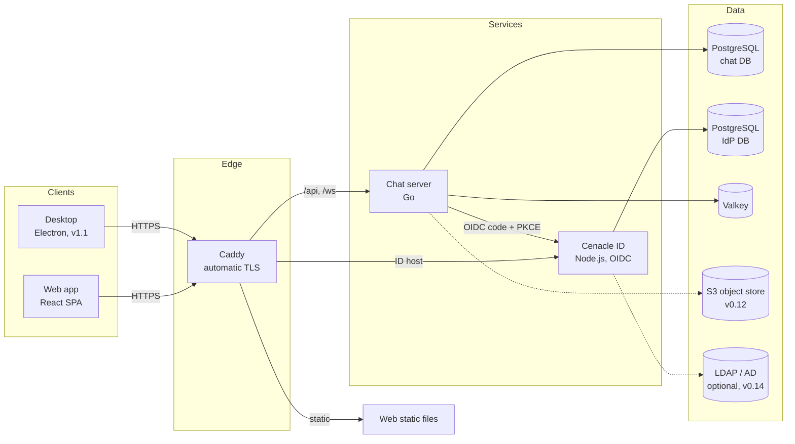

<p align="center">
  <picture>
    <source media="(prefers-color-scheme: dark)" srcset="web/public/brand/cenacle-lockup-dark.svg" />
    
  </picture>
</p>

# Cenacle

Cenacle is an open-source, fully self-hosted team chat (in the spirit of Discord and
Mattermost) with its own identity server, **Cenacle ID**. It is built to run on your own
infrastructure, without telemetry, CDNs or mandatory third-party services, and to work in
air-gapped networks.

> **Status: v0.25.** Sign in with Cenacle ID (passwords with two-step verification,
> passkeys, Active Directory/LDAP or your OpenID Connect or SAML provider), chat live in
> channels, forums, threads and direct conversations with profiles and custom statuses,
> link previews, voice messages, forwarding, custom emoji and stickers, burn-on-read
> messages, polls, events and playbooks, moderation with AutoMod, pin and save messages, search
> messages and files, choose what notifies you (sounds, muting, quiet hours, web push,
> e-mail), make Cenacle yours with theme presets and fonts, share files, connect bots and
> schedule messages, automate work with workflows, forms and approvals, keep canvases, lists and boards next to channels, meet compliance needs (retention, legal holds, eDiscovery, access rules, encrypted channels), use optional AI with a model you run, share channels with other Cenacle servers; run several instances, monitor, back up, install on Kubernetes or
> offline.
> Security testing comes next (see the [roadmap](#roadmap)).

## Highlights

- **Self-hosted by design:** one `docker compose` stack, automatic TLS (Caddy), file-based
  secrets, non-root containers, multi-arch images (amd64, arm64), `/healthz` and `/readyz`.
- **Separate identity server:** the chat backend is an OIDC client of Cenacle ID
  (Authorization Code + PKCE, RFC 9700) and issues its own opaque sessions.
- **Calm, predictable UI:** WCAG 2.2 target sizes (24/28/44 px) enforced in CI, safe
  patterns for destructive actions, undo instead of surprise, clear errors with request IDs,
  English and Turkish.
- **Permissive dependencies only:** license policy enforced in CI.

## Quick start (development)

Requirements: Go 1.26, Node.js 24 (`.nvmrc`), pnpm via Corepack, Docker with Compose v2.

```sh
corepack enable
pnpm install
make tools                  # pinned sqlc, oapi-codegen, golangci-lint, go-licenses, govulncheck
cp .env.example .env
make up                     # postgres, valkey, openldap, mailpit (healthy)
make migrate-up             # chat database migrations
make dev-server             # chat backend   -> http://localhost:8180/readyz
make dev-idp                # Cenacle ID     -> http://localhost:8190/healthz
make dev-web                # web app        -> http://localhost:15173
make dev-user EMAIL=you@example.com NAME="Your Name"   # asks for a password (15+ characters)
```

Open the app at <http://localhost:15173> and sign in with that account. Use `localhost`, not
`127.0.0.1`: the sign-in cookies are bound to the host name. Component gallery
(development only): <http://localhost:15173/dev/gallery>.

| Service         | Default port (localhost only) | Notes                                                                      |
| --------------- | ----------------------------- | -------------------------------------------------------------------------- |
| PostgreSQL 18   | 15432                         | databases `cenacle_chat` and `cenacle_idp` with separate owners            |
| Valkey 9        | 16379                         | cache, pub/sub, presence                                                   |
| OpenLDAP (test) | 13389                         | `dc=cenacle,dc=test`; users `alice`, `bob`, `carol` / `<uid>-dev-password` |
| Mailpit         | 11025 (SMTP), 18025 (UI)      | catches all outgoing mail                                                  |
| Chat server     | 8180                          | `make dev-server`                                                          |
| Cenacle ID      | 8190                          | `make dev-idp`                                                             |
| Web app         | 15173                         | `make dev-web`                                                             |

Ports are deliberately non-standard so Cenacle can run next to other stacks; change them
in `.env`. To run the application containers too:
`docker compose -p cenacle -f deploy/compose/dev.yml --env-file .env --profile apps up -d --build`.

### Make targets

| Target                               | Purpose                                         |
| ------------------------------------ | ----------------------------------------------- |
| `up` / `down` / `ps`                 | Start, stop and inspect the dev infrastructure  |
| `dev-server` / `dev-idp` / `dev-web` | Run a component locally                         |
| `migrate-up` / `migrate-down`        | Apply / roll back chat database migrations      |
| `gen`                                | Generate code (sqlc, OpenAPI server and client) |
| `dev-user`                           | Create a Cenacle ID account for development     |
| `lint` / `test` / `test-e2e`         | Linters + type checks / unit tests / Playwright |
| `test-e2e-stack`                     | Sign in end to end with all components running  |
| `licenses` / `vuln`                  | License policy check / Go vulnerability scan    |
| `build` / `images`                   | Build all components / container images         |

## Architecture



- **Chat server (`/server`):** Go, chi, pgx + sqlc, goose migrations embedded in the binary,
  spec-first API ([`server/api/openapi.yaml`](server/api/openapi.yaml), oapi-codegen), RFC
  9457 problem details for every error. Signs users in with Cenacle ID and keeps its own
  sessions ([ADR 0004](docs/adr/0004-chat-sign-in-and-sessions.md)). Live events go over
  WebSocket from a Valkey stream shared by all instances
  ([ADR 0005](docs/adr/0005-live-chat.md)). Channels everyone belongs to are set at
  installation; one administrator creates channels until roles arrive
  ([ADR 0006](docs/adr/0006-channel-membership.md)). Messages can be edited and deleted
  with undo; channels are renamed, archived and grouped in categories
  ([ADR 0007](docs/adr/0007-channel-and-message-management.md)). Workspaces have owners,
  admins and members, and people join with invitation links
  ([ADR 0008](docs/adr/0008-workspaces-and-roles.md)). Direct and group conversations,
  unread counts, presence and typing notices complete the live chat
  ([ADR 0009](docs/adr/0009-direct-messages-unread-presence.md)). Users see and end their
  signed-in devices, Cenacle ID's sign-outs reach the chat server, and an audit log records
  security-relevant actions
  ([ADR 0010](docs/adr/0010-two-step-verification-sessions-audit.md)). Messages carry
  Markdown, mentions, reactions and cards; events go through a transactional outbox and
  background work runs on River
  ([ADR 0011](docs/adr/0011-rich-messages-and-outbox.md)). Bots post through scoped tokens
  and incoming webhooks, Jira included
  ([ADR 0012](docs/adr/0012-bots-and-incoming-webhooks.md),
  [integrations guide](docs/integrations/README.md)).
- **Cenacle ID (`/idp`):** Node.js + TypeScript (Fastify), `node-oidc-provider`, Argon2id
  passwords, two-step verification with an authenticator app and recovery codes.
- **Web (`/web`) and design system (`/packages/ui`):** React 19, Vite, TanStack Router and
  Query, Tailwind CSS v4, shadcn/ui on Base UI. **`/packages/core`:** API client, shared
  types, local storage (drafts in IndexedDB).
- Decisions are recorded in [`docs/adr`](docs/adr).

## Repository layout

```text
server/          Go chat backend
idp/             Cenacle ID (identity server)
web/             React SPA
packages/core/   API/WS client, shared types, local storage (TS)
packages/ui/     design system: tokens, theme, primitives, UX components
deploy/          compose stacks (dev, prod), Caddy build; Helm later
docs/            ADRs, upgrade and backup guides, UX glossary
```

## Roadmap

| Version   | Scope                                                                                 |
| --------- | ------------------------------------------------------------------------------------- |
| v0.1      | Skeleton: services, design system foundations, infrastructure, CI                     |
| v0.2      | Cenacle ID core (OIDC provider)                                                       |
| v0.3      | OIDC sign-in in chat, sessions                                                        |
| v0.4      | Live chat, WebSocket tickets, channel membership, public and private channels         |
| v0.5      | Editing and deleting messages, channel settings, categories, quick switcher           |
| v0.6      | Workspaces, roles, invitations                                                        |
| v0.7      | Direct messages, unread, presence, typing                                             |
| v0.8      | TOTP MFA, session management, back-channel logout, audit log                          |
| v0.9      | Markdown, reactions, mentions, attachments, transactional outbox                      |
| v0.10     | Bot foundation, Jira to chat                                                          |
| v0.11     | Slash commands, event subscriptions, scheduled messages and reminders, GitLab, alerts |
| v0.12     | Files (S3-compatible object store), previews, viewer, virus scanning                  |
| v0.13     | Scaling and operations (multiple instances, OpenTelemetry, backups, Helm, air-gapped) |
| v0.14     | Identity federation (LDAP/AD, SAML and OIDC, WebAuthn), admin console, guests         |
| v0.15     | Profiles, profile cards, custom status, channel and workspace settings                |
| v0.16     | Appearance: theme presets, typography, fonts, code blocks                             |
| v0.17     | Search and notifications (sounds, muting, web push, e-mail)                           |
| v0.18     | Threads, pins, saved items, activity                                                  |
| v0.19     | Community and moderation: forums, polls, events, AutoMod, playbooks                   |
| v0.20     | Link previews, voice messages, forwarding, custom emoji                               |
| v0.21     | Automation: workflows, approvals, forms                                               |
| v0.22     | Collaboration: canvases, lists, boards, tasks                                         |
| v0.23     | Compliance: retention, legal hold, eDiscovery, export, access control                 |
| v0.24     | Optional, self-hosted AI (off by default)                                             |
| **v0.25** | **Federation between servers**                                                        |
| v0.26     | Security testing and hardening                                                        |
| v0.27     | Optimization and load tests                                                           |
| v0.28     | Release candidate                                                                     |
| v0.99     | Interface rewrite                                                                     |
| v1.0      | Stable                                                                                |
| v1.1      | Desktop app                                                                           |
| v1.2      | Voice and video                                                                       |
| v1.3      | Mobile apps                                                                           |

### Self-hosted installation roadmap

1. **v0.1:** production compose skeleton ([`deploy/compose/prod.yml`](deploy/compose/prod.yml),
   [installation and firewall guide](docs/install/README.md), [operations](docs/operations/README.md), [Kubernetes](docs/install/kubernetes.md)):
   Caddy, chat server, Cenacle ID, web, PostgreSQL, Valkey; secrets via
   `deploy/compose/gen-secrets.sh`, host names from `.env.prod`.
2. **v0.3–v0.12:** the stack becomes usable end to end; SMTP, LDAP and object storage stay
   optional and configurable.
3. **v0.13:** Helm chart, observability profile (OpenTelemetry, Prometheus, Loki, Tempo,
   Grafana), documented backups with pgBackRest/WAL-G.
4. **v1.0:** supported upgrade path between releases ([`docs/upgrade`](docs/upgrade)).

## Contributing and security

See [CONTRIBUTING.md](CONTRIBUTING.md) (DCO sign-off required) and
[SECURITY.md](SECURITY.md) for private vulnerability reports.

## License

Cenacle is free software under the [GNU Affero General Public License v3.0](LICENSE)
(`AGPL-3.0-only`): use, change and share it; if you offer a modified version to users over
a network, offer them its source too. The client library `packages/core` is under the
[Apache License 2.0](packages/core/LICENSE), so apps and bots can embed it under any
license. Contributions are accepted under the [Contributor License Agreement](CLA.md);
the name and logo follow the [trademark policy](TRADEMARKS.md).
