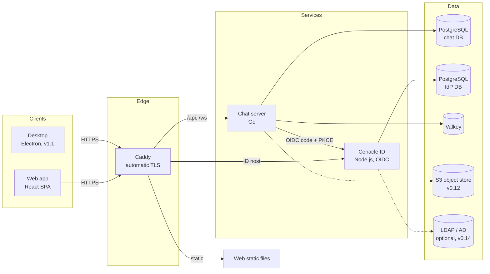

<p align="center">
  <picture>
    <source media="(prefers-color-scheme: dark)" srcset="web/public/brand/cenacle-lockup-dark.svg" />
    
  </picture>
</p>

# Cenacle

Cenacle is an open-source, fully self-hosted team chat (in the spirit of Discord and
Mattermost) with its own identity server, **Cenacle ID**. It is built to run on your own
infrastructure, without telemetry, CDNs or mandatory third-party services, and to work in
air-gapped networks.

> **Status: v0.8.** Sign in with Cenacle ID (with two-step verification) and chat
> live in channels and direct conversations.
> Direct messages, presence and unread counts follow (see the
> [roadmap](#roadmap)).

## Highlights

- **Self-hosted by design:** one `docker compose` stack, automatic TLS (Caddy), file-based
  secrets, non-root containers, multi-arch images (amd64, arm64), `/healthz` and `/readyz`.
- **Separate identity server:** the chat backend is an OIDC client of Cenacle ID
  (Authorization Code + PKCE, RFC 9700) and issues its own opaque sessions.
- **Calm, predictable UI:** WCAG 2.2 target sizes (24/28/44 px) enforced in CI, safe
  patterns for destructive actions, undo instead of surprise, clear errors with request IDs,
  English and Turkish.
- **Permissive dependencies only:** license policy enforced in CI.

## Quick start (development)

Requirements: Go 1.26, Node.js 24 (`.nvmrc`), pnpm via Corepack, Docker with Compose v2.

```sh
corepack enable
pnpm install
make tools                  # pinned sqlc, oapi-codegen, golangci-lint, go-licenses, govulncheck
cp .env.example .env
make up                     # postgres, valkey, openldap, mailpit (healthy)
make migrate-up             # chat database migrations
make dev-server             # chat backend   -> http://localhost:8180/readyz
make dev-idp                # Cenacle ID     -> http://localhost:8190/healthz
make dev-web                # web app        -> http://localhost:15173
make dev-user EMAIL=you@example.com NAME="Your Name"   # asks for a password (15+ characters)
```

Open the app at <http://localhost:15173> and sign in with that account. Use `localhost`, not
`127.0.0.1`: the sign-in cookies are bound to the host name. Component gallery
(development only): <http://localhost:15173/dev/gallery>.

| Service         | Default port (localhost only) | Notes                                                                      |
| --------------- | ----------------------------- | -------------------------------------------------------------------------- |
| PostgreSQL 18   | 15432                         | databases `cenacle_chat` and `cenacle_idp` with separate owners            |
| Valkey 9        | 16379                         | cache, pub/sub, presence                                                   |
| OpenLDAP (test) | 13389                         | `dc=cenacle,dc=test`; users `alice`, `bob`, `carol` / `<uid>-dev-password` |
| Mailpit         | 11025 (SMTP), 18025 (UI)      | catches all outgoing mail                                                  |
| Chat server     | 8180                          | `make dev-server`                                                          |
| Cenacle ID      | 8190                          | `make dev-idp`                                                             |
| Web app         | 15173                         | `make dev-web`                                                             |

Ports are deliberately non-standard so Cenacle can run next to other stacks; change them
in `.env`. To run the application containers too:
`docker compose -p cenacle -f deploy/compose/dev.yml --env-file .env --profile apps up -d --build`.

### Make targets

| Target                               | Purpose                                         |
| ------------------------------------ | ----------------------------------------------- |
| `up` / `down` / `ps`                 | Start, stop and inspect the dev infrastructure  |
| `dev-server` / `dev-idp` / `dev-web` | Run a component locally                         |
| `migrate-up` / `migrate-down`        | Apply / roll back chat database migrations      |
| `gen`                                | Generate code (sqlc, OpenAPI server and client) |
| `dev-user`                           | Create a Cenacle ID account for development     |
| `lint` / `test` / `test-e2e`         | Linters + type checks / unit tests / Playwright |
| `test-e2e-stack`                     | Sign in end to end with all components running  |
| `licenses` / `vuln`                  | License policy check / Go vulnerability scan    |
| `build` / `images`                   | Build all components / container images         |

## Architecture



- **Chat server (`/server`):** Go, chi, pgx + sqlc, goose migrations embedded in the binary,
  spec-first API ([`server/api/openapi.yaml`](server/api/openapi.yaml), oapi-codegen), RFC
  9457 problem details for every error. Signs users in with Cenacle ID and keeps its own
  sessions ([ADR 0004](docs/adr/0004-chat-sign-in-and-sessions.md)). Live events go over
  WebSocket from a Valkey stream shared by all instances
  ([ADR 0005](docs/adr/0005-live-chat.md)). Channels everyone belongs to are set at
  installation; one administrator creates channels until roles arrive
  ([ADR 0006](docs/adr/0006-channel-membership.md)). Messages can be edited and deleted
  with undo; channels are renamed, archived and grouped in categories
  ([ADR 0007](docs/adr/0007-channel-and-message-management.md)). Workspaces have owners,
  admins and members, and people join with invitation links
  ([ADR 0008](docs/adr/0008-workspaces-and-roles.md)). Direct and group conversations,
  unread counts, presence and typing notices complete the live chat
  ([ADR 0009](docs/adr/0009-direct-messages-unread-presence.md)). Users see and end their
  signed-in devices, Cenacle ID's sign-outs reach the chat server, and an audit log records
  security-relevant actions
  ([ADR 0010](docs/adr/0010-two-step-verification-sessions-audit.md)).
- **Cenacle ID (`/idp`):** Node.js + TypeScript (Fastify), `node-oidc-provider`, Argon2id
  passwords, two-step verification with an authenticator app and recovery codes.
- **Web (`/web`) and design system (`/packages/ui`):** React 19, Vite, TanStack Router and
  Query, Tailwind CSS v4, shadcn/ui on Base UI. **`/packages/core`:** API client, shared
  types, local storage (drafts in IndexedDB).
- Decisions are recorded in [`docs/adr`](docs/adr).

## Repository layout

```text
server/          Go chat backend
idp/             Cenacle ID (identity server)
web/             React SPA
packages/core/   API/WS client, shared types, local storage (TS)
packages/ui/     design system: tokens, theme, primitives, UX components
deploy/          compose stacks (dev, prod), Caddy build; Helm later
docs/            ADRs, upgrade and backup guides, UX glossary
```

## Roadmap

| Version  | Scope                                                                                 |
| -------- | ------------------------------------------------------------------------------------- |
| v0.1     | Skeleton: services, design system foundations, infrastructure, CI                     |
| v0.2     | Cenacle ID core (OIDC provider)                                                       |
| v0.3     | OIDC sign-in in chat, sessions                                                        |
| v0.4     | Live chat, WebSocket tickets, channel membership, public and private channels         |
| v0.5     | Editing and deleting messages, channel settings, categories, quick switcher           |
| **v0.6** | **Workspaces, roles, invitations**                                                    |
| v0.7     | Direct messages, unread, presence, typing                                             |
| v0.8     | TOTP MFA, session management, back-channel logout, audit log                          |
| v0.9     | Markdown, reactions, mentions, attachments, transactional outbox                      |
| v0.10    | Bot foundation, Jira to chat                                                          |
| v0.11    | Slash commands, event subscriptions                                                   |
| v0.12    | File uploads (S3-compatible object store)                                             |
| v0.13    | Scaling and operations (multiple instances, OpenTelemetry, load tests, backups, Helm) |
| v0.14    | Identity federation (LDAP/AD, WebAuthn), admin console                                |
| v1.0     | Hardening                                                                             |
| v1.1     | Desktop app                                                                           |

### Self-hosted installation roadmap

1. **v0.1:** production compose skeleton ([`deploy/compose/prod.yml`](deploy/compose/prod.yml),
   [installation and firewall guide](docs/install/README.md)):
   Caddy, chat server, Cenacle ID, web, PostgreSQL, Valkey; secrets via
   `deploy/compose/gen-secrets.sh`, host names from `.env.prod`.
2. **v0.3–v0.12:** the stack becomes usable end to end; SMTP, LDAP and object storage stay
   optional and configurable.
3. **v0.13:** Helm chart, observability profile (OpenTelemetry, Prometheus, Loki, Tempo,
   Grafana), documented backups with pgBackRest/WAL-G.
4. **v1.0:** supported upgrade path between releases ([`docs/upgrade`](docs/upgrade)).

## Contributing and security

See [CONTRIBUTING.md](CONTRIBUTING.md) (DCO sign-off required) and
[SECURITY.md](SECURITY.md) for private vulnerability reports.

## License

[Apache License 2.0](LICENSE).
